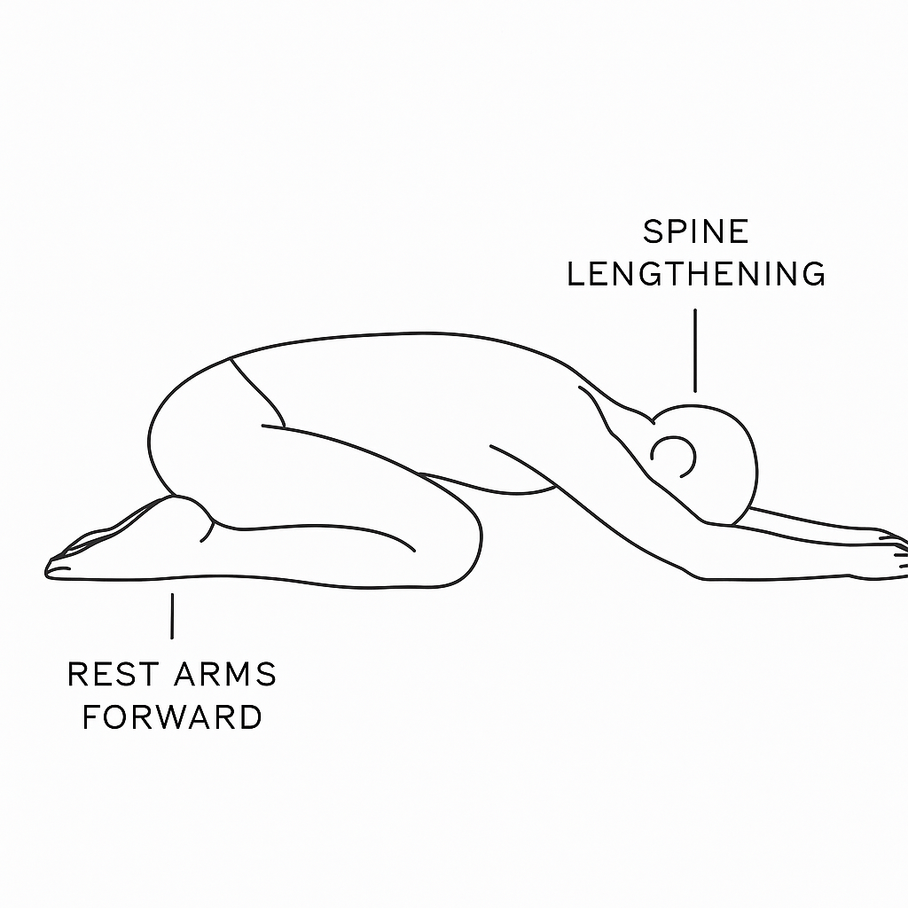
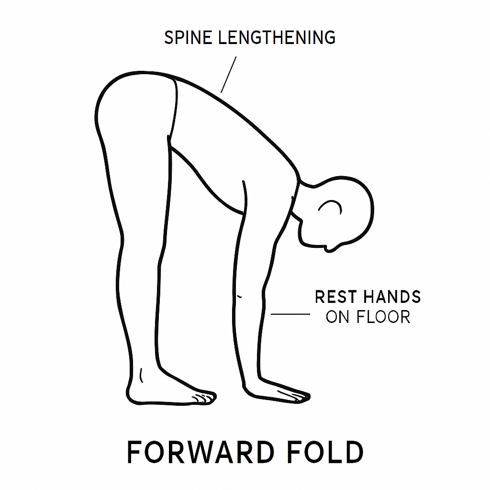
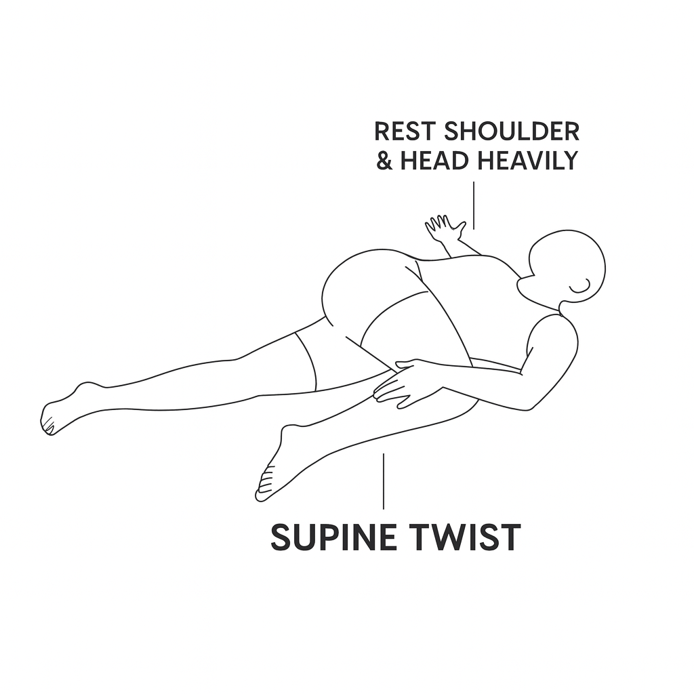

_A short sequence of passive, grounding positions that release neuromuscular tension and restore autonomic balance._

---

## 1. MECHANISM

Somatic Discharge Reset uses **slow, passive stretching positions** to reduce autonomic activation by:

- decreasing muscle spindle firing  
- activating slow-adapting mechanoreceptors  
- increasing parasympathetic tone  
- lengthening spinal fascia  
- reducing global bracing patterns  
- improving interoceptive accuracy

These effects lower sympathetic load and prepare the nervous system for cognitive flexibility and physical training.

---

## 2. PRIMARY PURPOSE

To discharge accumulated physical tension and autonomic activation through three grounding poses that restore bodily quiet and cognitive readiness.

---

## 3. WHEN TO USE IT

Use Somatic Discharge Reset when:

- the body feels tense, braced, or compressed  
- cognitive overload is accompanied by physical tightness  
- you feel physically restless or “keyed up”  
- the body blocks further cognitive reset  
- the spine or hips feel stiff  
- there’s lingering agitation before isometrics or active warm-ups

This is a body-based “pressure release valve.”

---

## 4. WHO RESPONDS BEST

This modality helps:

- people with chronic muscular tension  
- individuals who somatize stress  
- users who regulate through bodily stillness  
- restless or physically agitated individuals  
- people who cannot downshift through cognitive or social methods  
- those who prefer low-skill, low-effort techniques

It does not require flexibility or yoga experience.

---

## 5. SCIENTIFIC VALIDATION (SHORT VERSION)

Somatic Discharge Reset is supported by evidence showing that:

- long, passive stretches reduce sympathetic arousal  
- spinal flexion and rotation increase parasympathetic activation  
- head-below-heart positions activate baroreflex pathways  
- mechanoreceptor stimulation decreases neuromuscular bracing  
- interoceptive grounding improves emotional and cognitive regulation  
- passive holds improve vagal tone and respiratory quieting

This modality works through simple, physical mechanisms—not emotional processing.

---

## 6. THE SPL PROTOCOL (THE THREE-POSE SEQUENCE)

The Somatic Discharge Reset consists of **three passive positions** performed slowly and without performance goals.

All poses are held at **comfortable depth**, not maximal stretch.\
The intention is **release, not flexibility**.

---

### Pose 1 — Child’s Pose

**3–5 minutes**

**Purpose:**\
Flexion → diaphragmatic softening → spinal decompression → vagal activation.

**Instructions (SPL-neutral cues):**

- Kneel and fold your torso over your thighs.  
- Rest your forehead on the floor or a block.  
- Let your arms rest forward or alongside your body.  
- Allow the back to widen with each breath.  
- Settle weight into the ground.

---

### Pose 2 — Forward Fold (Standing or Seated)

**3–5 minutes**

**Purpose:**\
Posterior-chain decompression → head-below-heart downshift → passive lengthening.

**Instructions:**

- Stand or sit and hinge forward gently.  
- Bend your knees generously if needed.  
- Rest your hands on the floor, blocks, or legs.  
- Let your spine **hang** rather than “stretch.”  
- Allow gravity to do the work.

Important cue:\
**This is not a hamstring stretch.**\
**This is a spinal release.**

---

### Pose 3 — Supine Twist (Left + Right)

**3 minutes each side (6 total)**

**Purpose:**\
Rotational release → diaphragmatic wringing → parasympathetic rebound.

**Instructions:**

- Lie on your back.  
- Let both knees fall to one side.  
- Extend arms out or rest one hand on the ribs.  
- Keep shoulders heavy.  
- Allow the breath to slow naturally.  
- Switch sides after three minutes.

---

## 7. THE 15-MINUTE VERSION

A complete Somatic Discharge Reset:

1. **Child’s Pose** — 3–5 minutes  
1. **Forward Fold** — 3–5 minutes  
1. **Supine Twist** — 3 minutes each side

Total: **12–16 minutes** depending on comfort.

---

## 8. SHORT VERSIONS

### 3-Minute Version

Choose _one_ pose and hold it gently:

- Child’s Pose **or** Forward Fold

### 5-Minute Version

- Child’s Pose (2 minutes)  
- Forward Fold (3 minutes)

### 10-Minute Version

- Child’s Pose (3 minutes)  
- Forward Fold (3 minutes)  
- Supine Twist (2 minutes per side)

Short versions maintain passive, grounding intent.

---

## 9. FULL SCIENTIFIC VALIDATION

---

### 1. Muscle Spindle Inhibition

Long passive holds reduce spindle firing, lowering tonic muscle tension.

---

### 2. Mechanoreceptor Activation

Slow stretch stimulates SA mechanoreceptors (Ruffini endings), decreasing sympathetic arousal.

---

### 3. Baroreflex Activation

Head-below-heart positions enhance baroreceptor input, triggering parasympathetic dominance.

---

### 4. Vagal Stimulation Through Flexion

Flexed, compressed shapes (e.g., Child’s Pose) increase vagal afferent signaling via diaphragmatic contact.

---

### 5. Interoceptive Grounding

Stillness increases sensitivity to internal cues, improving prefrontal regulation.

---

### 6. Fascia & Spinal Decompression

Anterior flexion + passive traction + rotation release tension along thoracolumbar fascia.

---

### 7. Parasympathetic Rebound from Long Holds

Consistent evidence supports extended static positions as a reliable autonomic downshift mechanism.

---

### 8. Reduction of Hypertonicity

Passive positions reduce chronic bracing patterns without triggering compensatory contraction.

---

### 9. Preparatory Effect on Cognitive Load

Reduced bodily tension improves attention, working memory, and cognitive flexibility—supporting the next steps of the Gateway Protocol.
